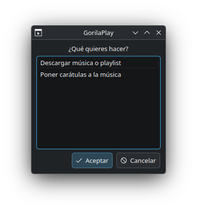
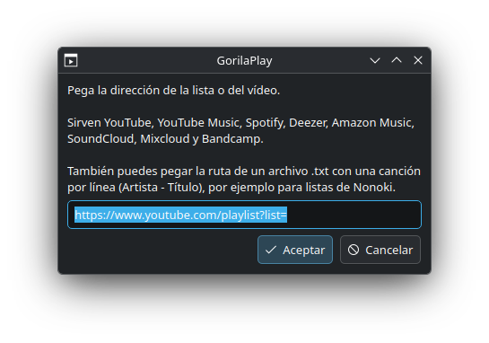
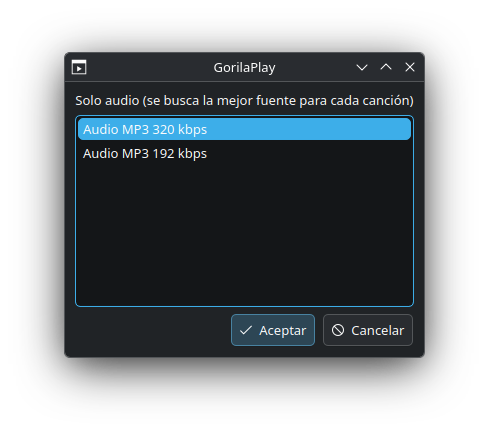
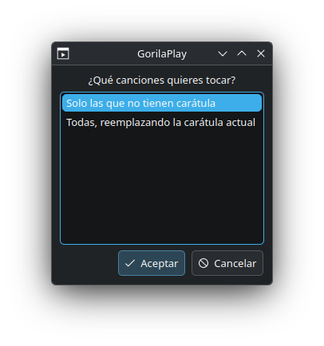

<p align="center">
  
</p>

<h1 align="center">GorilaPlay</h1>

<p align="center">
  Descargador de listas de música de varias plataformas, con interfaz gráfica.<br>
  Pega la URL, elige formato y carpeta, y listo.
</p>

---

<p align="center">
  <a href="#instalación-en-linux-probado-en-kde--nobara">Linux</a> ·
  <a href="#instalación-en-macos">macOS</a> ·
  <a href="#instalación-en-windows">Windows</a>
</p>

## Qué es

GorilaPlay es un lanzador sencillo para [yt-dlp](https://github.com/yt-dlp/yt-dlp)
pensado para no tener que escribir comandos. Acepta listas de:

- **YouTube** y **YouTube Music**: playlists, álbumes, vídeos sueltos y canales.
- **Spotify**: playlists, álbumes y canciones (los metadatos se leen de Spotify
  y el audio se busca fuera, porque Spotify no permite descargar su audio).
- **Deezer**: playlists, álbumes y canciones, con su API pública.
- **Amazon Music**: playlists, álbumes, artistas y canciones del catálogo
  público (sin cuenta).
- **SoundCloud** y **Mixcloud**.
- **Bandcamp** y cualquier otro sitio que soporte yt-dlp.
- **Una lista de texto** o un archivo `.txt` con una canción por línea. Es la
  vía para Nonoki y cualquier plataforma que no publique sus listas.

Cada canción se busca en YouTube y, si no hay una coincidencia clara, se prueba
en SoundCloud. Si tampoco, se pregunta a Deezer por el título oficial y se
reintenta. Así una canción que falta o está mal subida en un sitio puede
aparecer en el otro.

Formatos: MP3 320 kbps, MP3 192 kbps, audio original m4a o vídeo hasta 1080p
(estos dos últimos, solo para enlaces de YouTube).

## Características

- Diálogos nativos: sin terminal ni comandos para el uso diario.
- Crea una subcarpeta por playlist con el nombre de la lista.
- Nombra los archivos como `Artista - Título.mp3` e incrusta carátula y etiquetas.
- **Búsqueda con alternativas**: YouTube → SoundCloud → reintento con el título
  canónico de Deezer. El log dice de qué fuente salió cada canción.
- **Carátula propia en cada canción**: si la descarga no trae una buena, la busca
  en Deezer/iTunes y, si no la encuentra, usa la de la lista o la miniatura de
  YouTube.
- **Pone carátula a una carpeta ya descargada**: útil para discos bajados antes
  de tener esta función o para música que ya tenías.
- Registro de descargas: lo que ya has bajado no se vuelve a descargar.
- Log de cada ejecución para poder revisar errores.
- Al buscar descarta lyric, cover, karaoke, en vivo, etc., y prefiere canales
  oficiales (`... - Topic`, VEVO) y la duración que marca la plataforma de origen.

## Instalación en Linux (probado en KDE / Nobara)

Dependencias:

```bash
# yt-dlp (elige una)
pipx install yt-dlp
# o
pip install --user yt-dlp

# ffmpeg
sudo dnf install ffmpeg        # Fedora / Nobara
sudo apt install ffmpeg        # Debian / Ubuntu

# carátulas (Python + mutagen)
sudo dnf install python3-mutagen    # o: pip install --user mutagen

# diálogos y terminal
sudo dnf install kdialog konsole
```

Instalación:

1. Entra en **[la última release](https://github.com/4M4L4K4Ky/GorilaPlay/releases/latest)**
   y, en la sección **Assets**, descarga `GorilaPlay-X.Y.Z.zip`.
2. Descomprime el ZIP y abre una terminal dentro de esa carpeta.
3. Ejecuta:

   ```bash
   ./linux/instalar.sh
   ```

Si prefieres usar git (hace falta tener git instalado):

```bash
git clone https://github.com/4M4L4K4Ky/GorilaPlay.git
cd GorilaPlay
./linux/instalar.sh
```

Queda en el menú de aplicaciones como **GorilaPlay**. También puedes lanzarlo
desde una terminal con `descargar-playlist` y poner carátulas con
`gorilaplay-caratulas <carpeta>`.

## Instalación en macOS

Requisitos: macOS 11 o superior y [Homebrew](https://brew.sh). El instalador
prepara Python, FFmpeg, yt-dlp y mutagen en una carpeta propia, sin tocar el
Python del sistema.

Instalación:

1. Entra en **[la última release](https://github.com/4M4L4K4Ky/GorilaPlay/releases/latest)**
   y, en la sección **Assets**, descarga `GorilaPlay-X.Y.Z.zip`.
2. Descomprime el ZIP y abre una terminal dentro de esa carpeta.
3. Ejecuta:

   ```bash
   ./macos/instalar.sh
   ```

Si prefieres usar git (hace falta tener git instalado):

```bash
git clone https://github.com/4M4L4K4Ky/GorilaPlay.git
cd GorilaPlay
./macos/instalar.sh
```

Si falta Python o FFmpeg, el instalador avisa y los instala con Homebrew (pide
confirmación antes). Deja la aplicación en `~/Applications/GorilaPlay.app`, que
puedes abrir desde Finder o Launchpad, y estos comandos en `~/.local/bin`:

```bash
gorilaplay             # interfaz con diálogos del sistema
gorilaplay-lista       # descargar una lista desde la terminal
gorilaplay-caratulas   # poner carátulas a una carpeta
```

La primera vez, macOS puede avisar de que la aplicación no está firmada. Abre
`GorilaPlay.app` con clic derecho → *Abrir*, o ve a *Ajustes del Sistema →
Privacidad y seguridad* y elige *Abrir igualmente*.

La versión de macOS usa el mismo motor que la de Linux, así que también lee
Amazon Music, Spotify, Deezer, SoundCloud y las demás plataformas. Para el
audio y el vídeo necesita `yt-dlp` y `ffmpeg`, que ya instala el script.

## Instalación en Windows

Funciona en Windows 10 y 11 de 64 bits. No hace falta instalar Python, yt-dlp
ni ffmpeg: el instalador los descarga en una carpeta del usuario y no toca nada
del sistema.

1. Entra en **[la última release](https://github.com/4M4L4K4Ky/GorilaPlay/releases/latest)**
   y, en la sección **Assets**, descarga `GorilaPlay-X.Y.Z.zip`.
2. Clic derecho sobre el ZIP → **Extraer todo**. No ejecutes nada desde dentro
   del ZIP: Windows no puede abrir los archivos así.
3. En la carpeta extraída, haz doble clic en `windows\instalar.cmd`.
4. Si SmartScreen avisa, elige **Más información → Ejecutar de todas formas**
   (son scripts de texto plano; puedes abrirlos con el Bloc de notas).
5. Espera: copia el programa a `%LOCALAPPDATA%\Programs\GorilaPlay`, descarga
   `yt-dlp`, `ffmpeg` y `ffprobe`, y crea los accesos directos.
6. Abre **GorilaPlay** desde el escritorio o desde el menú Inicio.

Alternativa sin instalar: si prefieres no crear accesos directos, haz doble clic
en `windows\GorilaPlay.cmd` dentro de la carpeta extraída. La primera vez
descarga las dependencias en `windows\bin\`.

Si algo no arranca, abre `cmd` en la carpeta y ejecuta `windows\GorilaPlay.cmd`:
la ventana se queda abierta con el mensaje de error. El registro de la última
ejecución se guarda en `%LOCALAPPDATA%\GorilaPlay\gorilaplay.log`.

El botón **CARÁTULAS** hace lo mismo que en Linux: elige una carpeta y pone
portada a cada mp3/m4a que no la tenga.

El botón **LISTA .TXT** permite cargar un archivo de texto o pegar las
canciones directamente, con el mismo formato `Artista - Título` por línea.
También acepta enlaces de Deezer y de las demás plataformas que lee yt-dlp,
con búsqueda alternativa en YouTube y SoundCloud.

> De momento la lectura directa de Amazon Music está solo en la versión de
> Linux. En Windows, usa el botón **LISTA .TXT** con las canciones copiadas.

> La versión de Windows está portada pero menos probada que la de Linux. Si algo
> falla, abre un issue con el mensaje de error y el archivo `gorilaplay.log`.

## Uso

1. Abre **GorilaPlay**.
2. Pega la URL de la lista (o de un vídeo de YouTube, o la ruta de un `.txt`).
   En Windows y macOS la ventana lo pide directamente; en Linux elige antes
   **Descargar música o playlist**.
3. Elige el formato.
4. Elige la carpeta de destino (por defecto `~/Música`, o `Música` en Windows).
5. Pulsa **Aceptar** (**DESCARGAR** en Windows) y espera.

Resultado:

```
~/Música/
└── Mi lista de ejemplo/
    ├── Artista Uno - Título Uno.mp3
    ├── Artista Dos - Título Dos.mp3
    └── ...
```

Si una canción no aparece, prueba el motor de listas con alternativas: en el
mismo cuadro pega la ruta de un `.txt` con una canción por línea y el formato
`Artista - Título`. También puedes lanzarlo desde la terminal con
`gorilaplay-lista ~/listas/mi-lista.txt ~/Música`.

### Capturas

Menú principal y pegado del enlace:

<p align="center">
  
  
</p>

Elección del formato y de las carátulas:

<p align="center">
  
  
</p>

### Plataformas

| Plataforma | Cómo se lee |
|---|---|
| YouTube / YouTube Music | yt-dlp |
| Spotify | página pública de la lista (máximo 100 pistas) |
| Deezer | API pública |
| SoundCloud / Mixcloud | yt-dlp |
| Bandcamp y otros | yt-dlp |
| Amazon Music | API web pública (listas, álbumes, artistas y canciones) |
| Nonoki | lista de texto o `.txt` |

Amazon Music se lee directamente de su catálogo público, sin cuenta: pega la
URL de una playlist, un álbum, un artista o una canción y se obtienen sus
pistas. En los artistas se toman las canciones populares que muestra su ficha.

Nonoki (ahora Zozoki) no publica sus listas. Copia las canciones en un `.txt`,
una por línea, y pega su ruta en el primer cuadro de **Descargar música o
playlist**. El audio se busca igualmente en YouTube/SoundCloud.

### Spotify

Pega la URL de la playlist, álbum o canción de Spotify. GorilaPlay lee la lista
de pistas públicas y busca cada una primero en YouTube y luego en SoundCloud,
comparando duración y título.

Limitación: la vista pública de Spotify muestra como máximo **100 pistas**.
Si tu playlist es más larga, se descargarán las 100 primeras (te avisa en el log).

### Carátulas

Cada canción se queda con la portada del disco incrustada dentro del archivo (no
como imagen suelta), así que se ve en cualquier reproductor, en el móvil o en el
coche.

Al descargar se hace solo. Para música que ya tienes, GorilaPlay también pone
carátulas a una carpeta entera:

1. Abre **GorilaPlay**.
2. Elige **Poner carátulas a la música**.
3. Selecciona la carpeta.
4. Elige si solo toca las que no tienen carátula o si las reemplaza todas.

Desde una terminal:

```bash
gorilaplay-caratulas ~/Música/"Mi playlist"                # solo las que faltan
gorilaplay-caratulas ~/Música/"Mi playlist" --reemplazar   # todas otra vez
gorilaplay-caratulas ~/Música/"Mi playlist" --solo-probar  # ver qué encontraría
```

Busca primero en Deezer y después en iTunes, comparando título, artista y
duración; si no hay coincidencia clara, usa la miniatura de YouTube
(`--sin-youtube` para desactivarlo). También rellena título, artista y álbum
cuando faltan (`--sin-etiquetas` para no tocarlos).

Soporta MP3, M4A, FLAC, OGG y OPUS. No recomprime el audio: solo le añade la
imagen y las etiquetas. Si una canción se queda sin carátula, el programa lo
dice al final con la lista de las que han fallado.

### Desde la terminal

El instalador también deja el motor de listas accesible como
`gorilaplay-lista`:

```bash
gorilaplay-lista "https://www.deezer.com/es/playlist/123456789" ~/Música
gorilaplay-lista ~/listas/mi-lista.txt ~/Música --limit 10
gorilaplay-lista ~/listas/mi-lista.txt ~/Música --solo-probar
```

Acepta `--desde N` para reanudar, `--fuente youtube,soundcloud` para cambiar el
orden de búsqueda, `--sin-caratula` y `--nombre "Mi carpeta"`.

### Datos y registros

| Qué | Dónde (Linux y macOS) | Dónde (Windows) |
|---|---|---|
| Descargas ya hechas | `~/.local/state/gorilaplay/descargados.txt` | `%LOCALAPPDATA%\GorilaPlay\descargados.txt` |
| Logs | `~/.local/state/gorilaplay/*.log` | `%LOCALAPPDATA%\GorilaPlay\*.log` |

Borra el archivo de registro si quieres volver a descargar algo que ya bajaste.

## Problemas frecuentes

**No aparece la ventana / no sale el selector de carpeta**
En Linux falta `kdialog` o `konsole`: instálalos con el gestor de paquetes.
En macOS, vuelve a ejecutar `./macos/instalar.sh`; los diálogos son del sistema
y no necesitan nada más.

**En macOS dice que GorilaPlay no se puede abrir**
Es el aviso de una aplicación sin firma. Clic derecho sobre
`GorilaPlay.app` → *Abrir*, o *Ajustes del Sistema → Privacidad y seguridad* →
*Abrir igualmente*.

**En Windows no aparece la ventana o se cierra sola**
Abre `cmd` en la carpeta y ejecuta `windows\GorilaPlay.cmd`: así ves el mensaje.
Lo más rápido suele ser volver a ejecutar `windows\instalar.cmd`, que repara las
dependencias. El detalle queda en `%LOCALAPPDATA%\GorilaPlay\gorilaplay.log`.

**En Windows dice que no encuentra yt-dlp o ffmpeg**
Los descarga el instalador en `windows\bin\` o en
`%LOCALAPPDATA%\Programs\GorilaPlay\bin\`. Si falló la descarga (sin internet,
antivirus, proxy), vuelve a ejecutar `windows\instalar.cmd` con conexión.

**Windows bloquea el archivo al abrirlo (SmartScreen)**
*Más información → Ejecutar de todas formas*. Si el ZIP se descargó de internet,
es normal que avise la primera vez. También puedes desbloquearlo desde las
propiedades del ZIP antes de extraerlo.

**"No encuentro yt-dlp"**
Instálalo con `pipx install yt-dlp` y comprueba que `~/.local/bin` está en el PATH.

**YouTube pide iniciar sesión o dice que el vídeo no está disponible**
Actualiza yt-dlp (`yt-dlp -U`). Si sigue, exporta las cookies del navegador y
añade `--cookies-from-browser firefox` en el script.

**La descarga se corta o va lenta**
Es límite de YouTube. El script ya espera un segundo entre peticiones; puedes
subir `--sleep-requests` para ir más despacio.

**Alguna canción se queda sin carátula**
Deezer/iTunes no la tienen con ese título exacto. Prueba con
`gorilaplay-caratulas <carpeta> --reemplazar` (a veces la encuentra al segundo
intento) o ponle la portada a mano con tu reproductor. También puedes probar a
renombrar el archivo como `Artista - Título.mp3`, que es lo que usa para buscar.

## Estructura del repositorio

```
GorilaPlay/
├── assets/          icono (svg, png 1024/512/256, ico)
├── linux/           lanzador bash + motor de listas + carátulas + instalador
├── macos/           lanzador con diálogos del sistema + instalador
├── windows/         instalador + port en PowerShell + lanzador .cmd
├── LICENSE
└── README.md
```

## Aviso legal

GorilaPlay solo descarga contenido que tú tengas derecho a descargar. Respeta
los términos de servicio de cada plataforma y los derechos de autor de las obras.
El proyecto no aloja ni distribuye audio.

## Créditos

- Motor de descarga: [yt-dlp](https://github.com/yt-dlp/yt-dlp)
- Conversión de audio: [FFmpeg](https://ffmpeg.org/)
- Icono e interfaz: proyecto GorilaPlay

Licencia MIT.
